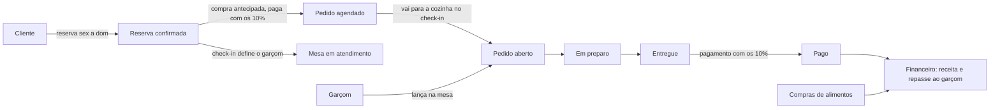

# Mesa Pronta

Sistema de gestão para um restaurante pequeno que atende com reserva de sexta a domingo. O cliente vê o cardápio, reserva a mesa e pode pagar o pedido antes de chegar. A equipe lança pedidos na mesa, acompanha a cozinha e registra pagamentos. O admin cuida do cardápio, das mesas, das compras de alimentos e do financeiro, com os 10% de cada garçom.

- **Backend:** Node.js, Express 5, Sequelize, PostgreSQL, Zod, JWT, Bcrypt, Swagger
- **Frontend:** React 19, Vite, MUI 9, React Router

## Como funciona



Regras principais:

- Reservas só às sextas, sábados e domingos, nos horários fixos da casa (12:00, 13:30, 19:00, 20:30 e 22:00) e no futuro. Uma reserva ativa por mesa e horário, garantida por índice único no banco.
- Sem mesa escolhida, o sistema reserva a menor mesa livre que comporta o grupo.
- O preço de cada item vem do cardápio no backend, nunca do front, e fica copiado no pedido: mudar o cardápio não altera pedidos antigos.
- A taxa de serviço (10%) vai para o garçom que lançou o pedido. Na compra antecipada, vai para o garçom definido no check-in. Ela não conta como receita do restaurante.
- Dinheiro em centavos (inteiros) do banco ao front, para não haver erro de arredondamento.
- Pagamento simulado: o sistema registra a forma (Pix, crédito, débito, dinheiro), sem cobrança real.

## Perfis (RBAC)

| Perfil | Pode |
|---|---|
| Cliente | Cadastrar-se, reservar, cancelar a própria reserva, comprar antecipado e pagar |
| Funcionário | Lançar pedidos (é o garçom deles), avançar preparo, registrar pagamento, ver a agenda, fazer check-in e cancelar reservas |
| Admin | Tudo do funcionário, mais usuários, cardápio, mesas, compras e financeiro |

O cadastro público cria sempre cliente. Funcionários e admins são criados pelo admin.

## Como rodar

Requer Node 22 (`nvm use`) e um PostgreSQL. Pode ser local, no Docker ou no Supabase (pela `DATABASE_URL`).

```bash
# Backend
cd backend
cp .env.example .env        # preencha o banco, JWT_SECRET, ADMIN_EMAIL e ADMIN_SENHA
npm install
npm run db:reset -- --demo  # cria as tabelas, o admin e os dados de demonstração
npm run dev                 # API em http://localhost:3000, documentação em /docs

# Frontend (outro terminal)
cd frontend
cp .env.example .env
npm install
npm run dev                 # http://localhost:5173
```

Contas da demonstração (senha `senha123`): `carlos@mesapronta.dev` e `beatriz@mesapronta.dev` (funcionários) e `ana@mesapronta.dev` (cliente). O admin é o do `.env`.

Scripts do backend:

| Script | O que faz |
|---|---|
| `npm run dev` | Sobe a API com recarga automática |
| `npm test` | Testes das regras (reserva, fuso, valores, validações, CORS) |
| `npm run seed` | Cria as tabelas que faltam e o admin do `.env` |
| `npm run seed:demo` | Admin mais dados de demonstração (banco vazio) |
| `npm run db:reset` | **Apaga tudo** e recria as tabelas. Use depois de mudar um model. `-- --demo` inclui a demonstração |

## Documentação da API

Com a API no ar, a documentação interativa fica em `http://localhost:3000/docs` (Swagger) e a especificação em `/docs.json`. Rotas autenticadas usam `Authorization: Bearer <token>`, obtido em `POST /auth/login`.

| Método e rota | O que faz | Acesso |
|---|---|---|
| `POST /auth/cadastro` | Cria conta de cliente | Público |
| `POST /auth/login` | Devolve o token JWT (expira em 1h) | Público |
| `GET`, `PATCH /usuario/perfil` | Perfil do usuário logado | Logado |
| `PATCH /usuario/senha`, `DELETE /usuario/conta` | Troca a senha, desativa a conta | Logado |
| `GET`, `POST /admin/usuarios` | Lista (filtro por perfil) e cria funcionário ou admin | Admin |
| `PATCH /admin/usuarios/:id/desativar` e `/reativar` | Bloqueia ou libera o acesso | Admin |
| `GET /cardapio` | Cardápio disponível | Público |
| `GET`, `POST /produtos`, `PATCH /produtos/:id` | Gestão do cardápio | Admin |
| `GET /mesas` | Lista as mesas | Funcionário e admin |
| `POST /mesas`, `PATCH /mesas/:id` | Gestão das mesas | Admin |
| `GET /reservas/opcoes`, `GET /reservas/disponibilidade` | Dias, horários e mesas livres | Público |
| `POST /reservas`, `GET /reservas/minhas` | Reserva e lista do cliente | Cliente |
| `POST /reservas/:id/pedido` | Compra antecipada | Cliente dono |
| `GET /reservas` | Agenda (filtro por data e status) | Funcionário e admin |
| `PATCH /reservas/:id/cancelar` | Cancela (e estorna a compra antecipada) | Dono ou equipe |
| `PATCH /reservas/:id/check-in`, `/concluir` | Chegada com garçom e encerramento | Funcionário e admin |
| `GET`, `POST /pedidos` | Lista e lança pedido na mesa | Funcionário e admin |
| `PATCH /pedidos/:id/status`, `/cancelar` | Preparo e cancelamento | Funcionário e admin |
| `POST /pedidos/:id/pagamento` | Registra o pagamento | Funcionário e admin |
| `GET`, `POST /compras`, `PATCH`, `DELETE /compras/:id` | Compras de alimentos | Admin |
| `GET /financeiro/resumo` | Receita, despesa, saldo, repasse por garçom, mais vendidos | Admin |

Exemplo: lançar um pedido na mesa.

```http
POST /pedidos
Authorization: Bearer <token do garçom>
Content-Type: application/json

{ "mesaId": "…", "itens": [{ "produtoId": "…", "quantidade": 2 }], "observacao": "Sem cebola" }
```

A resposta traz o pedido com `subtotalCentavos`, `taxaServicoCentavos` e `totalCentavos` calculados pelo backend. Erros seguem sempre o formato `{ mensagem, detalhes: [{ campo, mensagem }] }`.

## Requisitos técnicos da atividade

| Requisito | Onde está |
|---|---|
| RBAC com admin, funcionário e cliente | `constants/roles.js`, `middlewares/authorize.middleware.js` e `autorizar(...)` em cada rota |
| JWT com expiração | `services/auth.service.js` (`JWT_EXPIRES_IN`) e `middlewares/auth.middleware.js` |
| Senhas com Bcrypt | `services/auth.service.js` e `services/admin.service.js` |
| Validação com Zod | `schemas/` e `middlewares/validator*.middleware.js` |
| CORS | `config/cors.js` (`CORS_ORIGINS` em produção) |
| Erros padronizados | `utils/AppError.js` e `middlewares/error.middleware.js` |
| Camadas | `routes` → `controllers` → `services` → `models` |
| Documentação da API | Swagger em `/docs`, gerado dos blocos `@openapi` em `routes/` |

## Estrutura

```
backend/
├── src/
│   ├── config/       # banco, CORS, helmet, rate limit, Swagger
│   ├── constants/    # perfis e regras da casa (dias, horários, 10%, status)
│   ├── routes/       # rotas e documentação @openapi
│   ├── controllers/  # recebem a requisição e respondem
│   ├── services/     # regras de negócio
│   ├── models/       # Sequelize (index.js liga as associações)
│   ├── schemas/      # validação Zod
│   ├── middlewares/  # autenticação, perfil, validação, erros
│   ├── seeds/        # admin, demonstração e reset
│   └── utils/        # regras puras (fuso, valores) e utilitários
└── tests/
frontend/             # ver frontend/README.md
```
